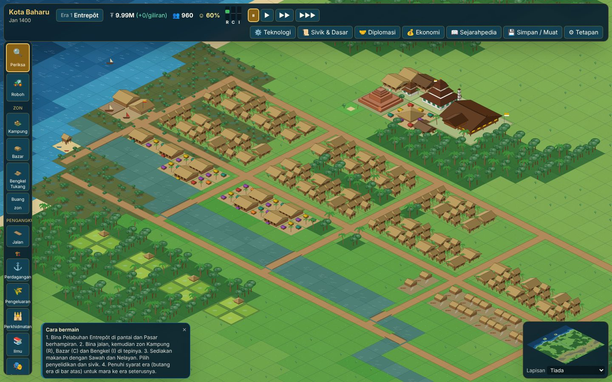
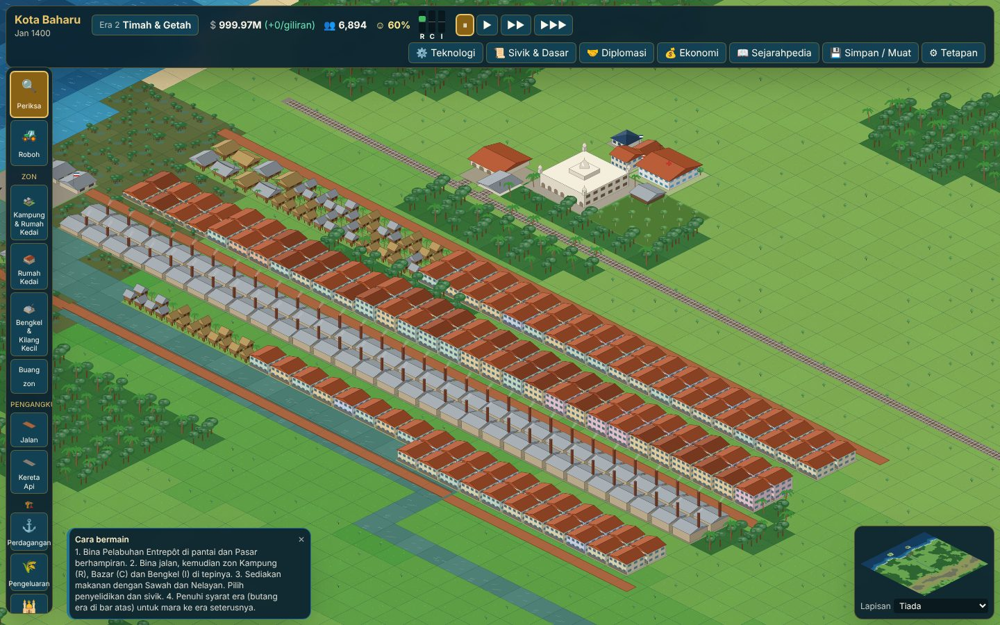
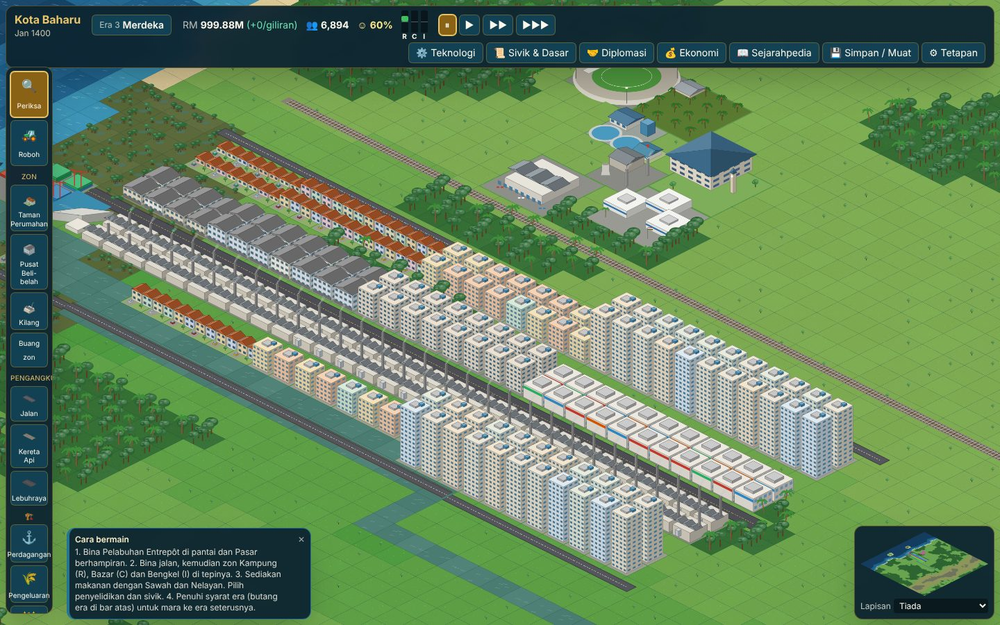
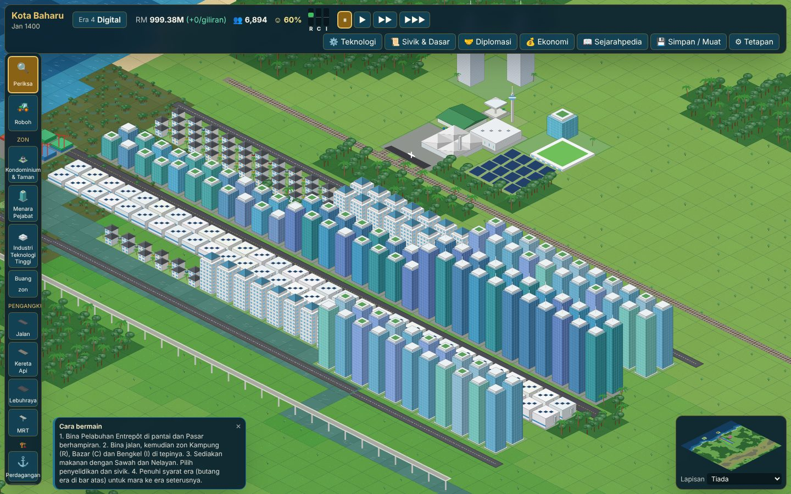

# Tamadun & Kota: Sejarah Malaysia

An isometric city-building and era-progression strategy game for the browser. Grow a riverside settlement on the Straits of Melaka from a **maritime entrepôt** into a **digital smart city**, across four eras of Malaysian history.

It combines city-builder mechanics (zoning, road/rail/river logistics, utilities, land value, pollution) with civilization-style progression (technology and civic trees, policies, era advancement, trade diplomacy with historical partners). Every graphic is drawn procedurally on HTML5 Canvas: the project contains no image assets.



| Era 2: Tin, Rubber & Rail | Era 3: Post-Merdeka | Era 4: Digital Smart City |
| --- | --- | --- |
|  |  |  |

## Features

- **Procedural Malaysian west-coast maps** (seeded): the Straits of Melaka to the west with offshore islands, a granite main range in the east, a meandering river with a mangrove-fringed estuary, lowland rainforest, fertile alluvial plains, and tin deposits in the foothills and valley floor (the Kinta / Larut pattern).
- **Four playable eras**, each with its own architecture, buildings, goods, prices, trade partners and events:
  1. **Maritime Entrepôt** (Bujang Valley to the Melaka Sultanate): kampung on stilts, bazaars, jong shipyards, tiered-roof mosques, candi, the Sultanate palace.
  2. **Tin, Rubber & Rail** (1824–1955): open-cast mines, bucket dredges, rubber estates, shophouses, railways, an Indo-Saracenic grand station.
  3. **Post-Merdeka Industrialisation** (1957–1995): housing estates (taman), flats, free trade zones, a national car plant, power and water utilities, expressways, container ports.
  4. **Digital Smart City** (1996+): condominiums, glass office towers, data centres, innovation hubs, solar farms, an elevated MRT, an international airport and the Twin Towers victory landmark.
- **Zoning**: Residential (Kampung → Taman → Kondominium), Commercial (Bazar → Rumah Kedai → Pusat Beli-belah → Menara Pejabat), Industrial (Bengkel → Kilang → high-tech). Lots grow with RCI demand, transport access, land value and (from era 3) power and water. Lots keep the architectural style of the era in which they last grew, so old kampung survive among new towers.
- **Multimodal logistics**: roads, railways, expressways, MRT lines, rivers and sea lanes form one network. A multi-source Dijkstra from ports and markets gives every tile a delivery cost; production efficiency falls with distance, so railways to inland tin mines matter.
- **Economy**: 11 goods (rice, fish, timber, spices, iron, tin, rubber, palm oil, manufactured goods, electronics, digital services), stockpiles and storage, export capacity, food imports, taxes, upkeep, public administration costs, loans, and commodity price events.
- **Tech & civic trees**: 41 technologies and 25 civics with historical dates, 9 policies with limited slots per era, and era requirements (key research, population and a landmark).
- **Trade diplomacy** with 18 historical partners (Ming China, Gujarati merchants, Ryukyu, the Straits Settlements, Japan, ASEAN, the EU and others): relations, envoys, trade deals at negotiated prices, knowledge exchange, and partner-initiated offers and investments.
- **Historical events** (Zheng He's fleet, the fall of Melaka in 1511, the Larut tin discovery, the first railway in 1885, the rubber boom, the Great Depression, Merdeka, ASEAN, the 1985 tin crisis, the Asian financial crisis, monsoon floods, haze and more).
- **Sejarahpedia**: a bilingual in-game encyclopedia with 40 entries, each with sources; disputed dates are presented as disputed.
- **Bilingual UI**: Bahasa Melayu and English, switchable at any time.
- **Save / Load**: three slots plus autosave in localStorage, JSON file export/import, and copy/paste of the save JSON. Saves are versioned and validated with zod; map layers are run-length encoded.

## Playing

```bash
npm install
```

```bash
npm run dev
```

Then open the printed local URL.

1. Build an **Entrepôt Harbour** on the coast and a **Pasar** nearby.
2. Lay roads, then zone **Kampung (R)**, **Bazar (C)** and **Bengkel (I)** beside them.
3. Feed people with **Paddy Fields** and **Fishing Villages**. Pick research and civics.
4. Open the era button in the top bar to see what is needed to advance.

**Controls**: drag with the right or middle mouse button (or the left button with the Inspect tool), or use arrow keys/WASD, to move the camera; mouse wheel or pinch to zoom; drag to lay roads and zones; right-click or Esc cancels a tool; Space pauses; 1-3 set the speed.

## Development

| Command | What it does |
| --- | --- |
| `npm run dev` | Vite dev server |
| `npm run build` | Typecheck and production build to `dist/` |
| `npm run build:artifact` | Single self-contained HTML page (`dist-artifact/tamadun-kota.html`) for hosts that supply their own page skeleton; file export is hidden there in favour of copy/paste JSON |
| `npm test` | Vitest unit, integration, render and UI tests |
| `npm run typecheck` / `npm run lint` | TypeScript and ESLint |
| `npm run check` | All three of the above |
| `npm run e2e` | Builds, serves and drives the real UI in Chromium (Playwright) |
| `npm run screenshots` | Regenerates the images in `docs/screenshots/` |

### Architecture

```
src/core/      pure TypeScript game rules (no DOM): fully unit-testable
  map/         seeded terrain generator
  data/        buildings, goods, eras, research, partners, events
  sim/         transport & logistics, zoning, economy, environment,
               research & eras, diplomacy, events, placement
  save/        versioned save format, codecs, localStorage slots
  engine.ts    GameEngine: tick loop and command API
src/render/    isometric projection, renderer and procedural sprite generators
src/ui/        React + Tailwind interface
src/i18n/      Malay / English strings
src/content/   Sejarahpedia entries with sources
tests/         Vitest suites; tests/helpers/bot.ts is a scripted player
e2e/           Playwright smoke test and screenshot scripts
```

The simulation runs one tick per "turn" (6 months in era 1, 4 in era 2, 2 in era 3, 1 in era 4). The React UI subscribes to the engine with `useSyncExternalStore`; the canvas renderer draws only visible tiles in painter's order from cached offscreen sprites.

### Tests

`npm test` runs 168 tests in 11 files, including a 650-tick soak test on three map seeds in which a scripted player must progress to at least era 3 without NaN, negative stock or out-of-range values. `npm run e2e` runs 18 browser checks (placing buildings with the mouse, dragging roads and zones, running time, choosing research, saving, reloading the page and loading, switching language) and fails on any console error.

## Historical accuracy

Dates and claims were checked against online sources while writing the content. Where sources disagree the game says so, for example:

- the dating of Sungai Batu (most recent radiocarbon work supports the 2nd to 10th centuries AD rather than earlier claims);
- the first rubber planting at Kuala Kangsar in 1877 by Hugh Low, with H. N. Ridley's later tapping work (the planting is sometimes misattributed to Ridley);
- the year of Zheng He's first call at Melaka (1405, 1407 or 1409 depending on the source);
- the first tin dredge at Batu Gajah (installed around 1912, operating successfully from January 1913).

Real companies and buildings are referred to generically in play (the "national car", the "Twin Towers") and the landmark designs are original. Each Sejarahpedia entry lists its sources.
