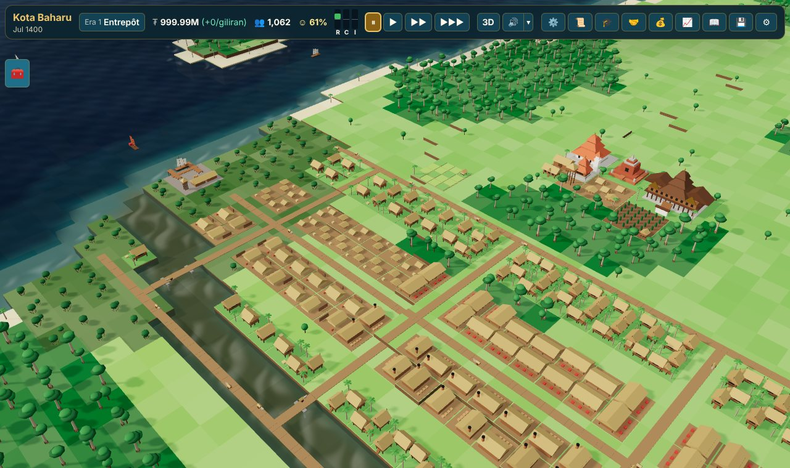
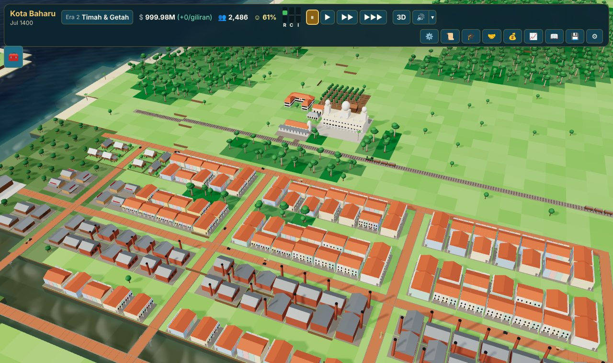
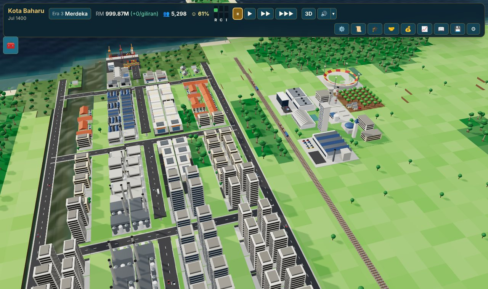
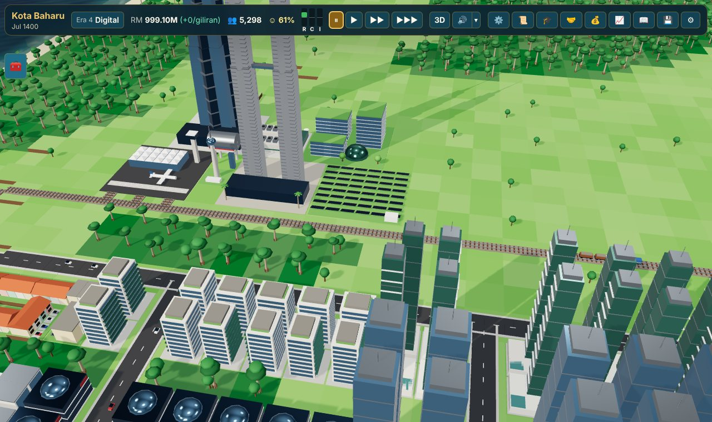
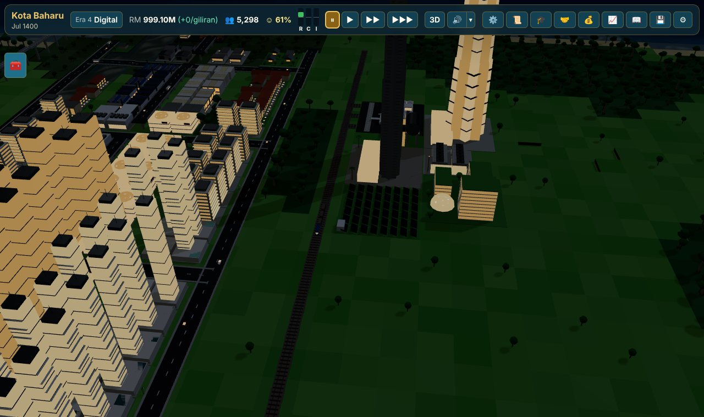

# Tamadun & Kota: Sejarah Malaysia

A **3D city-building and era-progression strategy game** for the browser. Grow a riverside settlement on the Straits of Melaka from a **maritime entrepôt** into a **digital smart city**, across four eras of Malaysian history.

It combines city-builder mechanics (zoning, road/rail/river logistics, utilities, land value, pollution) with civilization-style progression (technology and civic trees, policies, historical advisors, crises, era advancement, trade diplomacy with historical partners). Version 2.0 adds a full Three.js WebGL renderer fed by a headless-Blender glTF asset pipeline, a procedural Web Audio soundtrack, three starting scenarios and new late-game systems. The original isometric canvas renderer remains as the **2D Classic View**, one click away.

**Play it:** after the first push to `main`, GitHub Actions publishes the game to GitHub Pages (`https://izztnrhkm.github.io/malaysia-civ-simcity/`). See [Deployment](#deployment).



| Era 2: Tin, Rubber & Rail | Era 3: Post-Merdeka | Era 4: Digital Smart City | Era 4 at night |
| --- | --- | --- | --- |
|  |  |  |  |

## What's new in 2.0

### 3D world (Three.js / WebGL)
- **Terraced 3D terrain** in 16×16-tile chunks: deep ocean, shallow Straits, mangrove estuary, sandy beaches, rainforest, fertile plains and the tin-rich Titiwangsa foothills, with cliff walls and a diorama skirt at the map edge.
- **Animated water shader** (per-pixel swell normals, depth tint from the terrain, shoreline foam, sun glint, night tint).
- **126 procedural 3D models** loaded as instanced meshes: all 51 buildings, 39 zoned-lot tiers (kampung stilt houses with *bumbung panjang* roofs, five-foot-way shophouses with arched windows, FELDA homes, taman terraces, flats and condominiums, bazaars to glass office towers, craft workshops to semiconductor fabs), 13 vehicles and ships, 6 tree species and 15 transport pieces (roads by era, railway, elevated expressway viaducts, MRT guideway, bridge piers, street lamps).
- **Living city**: cars that drive on the left, bullock carts and vintage cars in earlier eras, steam and diesel trains with wagons, MRT trains, *jong*, junks, steamships and container ships sailing the Straits and calling at your ports, *perahu* on the river.
- **Lighting**: sun/moon directional light with real-time shadow maps, image-based lighting for metal and glass, a day / night / cycle toggle (windows glow at night) and monsoon rain with lightning (rain follows flood events automatically).
- **Camera**: OrbitControls with pan, zoom-to-cursor, 360° rotation and pitch from top-down strategy view to low skyline view, a **Reset Camera** button and keyboard control (WASD/arrows pan, Q/E rotate, +/- zoom, Home resets).
- **Interaction**: `THREE.Raycaster` picking against terrain chunks and the water surface, drag-to-build roads and zones, and a translucent ghost of the building being placed (green when valid, red when not), with the cost label.
- **3D / 2D Classic View** toggle in the top bar. Without WebGL (old GPUs, blocked contexts, unit tests) the game falls back to the 2D view automatically; on software renderers the graphics quality drops to "Low" (no shadows) unless you choose otherwise in Settings.

### Headless Blender glTF 2.0 pipeline
The architecture is described once, procedurally, in TypeScript (`src/render3d/models/`) as lists of parametric parts (box, frustum, gable prism, cylinder/cone, ellipsoid/dome) with PBR materials: tropical hardwood, *attap* thatch, terracotta tiles, pastel heritage plaster, rusted and corrugated tin, brick and laterite, steel, chrome and reflective glass.

- `scripts/generate_blender_models.py` (Blender `bpy` + `bmesh`) rebuilds every part with a Python port of the same generators, creates Principled-BSDF materials, and exports one `.glb` per model to `public/models/` with a `manifest.json`.
- `scripts/generate-glb.ts` is the no-Blender fallback: a binary glTF 2.0 packer that writes valid `.glb` files directly from Node.
- The game loads the `.glb` files with `GLTFLoader`. In the single-file Artifact build, where external fetches are blocked, the same meshes are built inline from the TypeScript catalog, so it renders identical models with zero network requests.

### Procedural sound (Web Audio, no dependencies)
- **Eras 1-2:** gamelan-inspired music in slendro- and pelog-like tunings: saron/bonang metallophones with paired detuned partials that beat like a gamelan's *ombak*, colotomic gong and kenong strokes and a breathy *seruling* (bamboo flute) with vibrato.
- **Eras 3-4:** warm detuned synth pads on seventh and ninth chords, soft bass and (era 4) delayed glassy arpeggios.
- **Effects:** building placement, road and zone dragging, bulldozing, coins, research fanfare, monsoon thunder, crisis stings, era transitions and victory.
- Mute / volume (master, music, effects) in the top bar, remembered between sessions. Audio starts only after a click, as browsers require.

### Gameplay expansion
- **Three scenarios** on the New Game screen: *1400 Rise of the Melaka Entrepôt* (full campaign), *1875 Larut & Kinta Tin Rush* (era 2, a mining town with no railway yet) and *1996 MSC & Smart Nation Corridor* (era 4, an industrial city starting its digital transition).
- **Historical crises with policy choices**: Changing Monsoon Winds (era 1), the 1926 Great Flood (*Bah Besar*), the Great Depression commodity crash and the 1931 tin restriction scheme, the 1985 tin market collapse and the 1997 Asian Financial Crisis. Each pauses for a decision with trade-offs; if you ignore it, the default applies after 8 turns.
- **Historical advisors (Tokoh Sejarah)**: Tun Perak, Tun Sri Lanang, Long Jaafar, Yap Ah Loy, H. N. Ridley, Za'ba, Tun Abdul Razak, Lim Chong Eu, Ungku Aziz and P. Ramlee, each with a passive buff, a stipend, bilingual biographies and sources. Seats grow with the era; advisors retire when the city moves past their era.
- **Victory milestones**: Economic Hegemon, Smart Nation Pioneer and Cultural Heritage Metropolis (which rewards preserving era 1-2 kampung and shophouses), alongside the classic Developed Nation victory.
- **Timeline & Victory panel**: treasury, population and output over time as small-multiple charts with era bands, a hover crosshair and a table view.
- **Late-game rebalance**: in eras 3-4, capital depreciation, network maintenance and city-size-dependent upkeep grow with the city ("Infrastructure maintenance" in the budget). In scripted 900-turn runs the era 4 treasury now ends around RM 0.25-0.45M instead of RM 1.25-1.43M; eras 1-2 are unchanged.
- **New buildings**: Watchtower (era 1, cuts pirate raids), Parliament House (era 3), Flood Mitigation Barrage (era 3, shields nearby tiles from flood losses) and Megatower 118 (era 4 landmark).

### Responsive HUD
Collapsible toolbar drawer, collapsible minimap and a menu drawer for the panels on phones; the 3D view supports one-finger building and two-finger orbit/zoom on touch screens.

## Features carried over from 1.0

- **Procedural Malaysian west-coast maps** (seeded): the Straits of Melaka with offshore islands, a granite main range, a meandering river with a mangrove-fringed estuary, lowland rainforest, fertile alluvial plains, and tin in the foothills and valley floor.
- **Four eras**, each with its own architecture, buildings, goods, prices, partners and events: Maritime Entrepôt, Tin, Rubber & Rail, Post-Merdeka Industrialisation and Digital Smart City.
- **Zoning** with RCI demand, land value, transport access and (from era 3) power and water. Lots keep the style of the era in which they last grew, so old kampung survive among new towers.
- **Multimodal logistics** (roads, railways, expressways, MRT, rivers, sea lanes) with a multi-source Dijkstra delivery cost.
- **Economy** with 11 goods, storage, exports, food imports, taxes, upkeep, administration, loans and commodity price events.
- **41 technologies and 25 civics** with historical dates, 9 policies, era requirements.
- **Trade diplomacy** with 18 historical partners.
- **Sejarahpedia**: 40 bilingual encyclopedia entries with sources; disputed dates are presented as disputed.
- **Bahasa Melayu and English**, switchable at any time.
- **Save / Load**: three slots plus autosave, JSON file export/import and copy/paste. Saves are validated with zod and map layers run-length encoded.

### Save compatibility
Version 2.0 keeps the save format at version 1 and only adds optional fields (`scenario`, `advisors`, `crisis`, `crisisLog`, `milestones`, history `output`/`era`). Saves from the 1.0 release load unchanged (a real 1.0 save is part of the test suite), and the 1.0 release can still open 2.0 saves that do not contain the four new 2.0 buildings (it ignores the new fields, but rejects building types it does not know).

## Playing

```bash
npm install
```

```bash
npm run dev
```

Then open the printed local URL.

1. Pick a scenario. In the campaign, build an **Entrepôt Harbour** on the coast and a **Pasar** nearby.
2. Lay roads, then zone **Kampung (R)**, **Bazar (C)** and **Bengkel (I)** beside them.
3. Feed people with **Paddy Fields** and **Fishing Villages**. Pick research and civics; appoint an advisor.
4. Open the era button in the top bar to see what is needed to advance, and the 📈 panel for victory milestones.

**3D controls**: left-drag pans (Inspect tool), right-drag orbits, wheel or pinch zooms; with a build tool the left button places or drags; right-click without moving cancels the tool; Esc cancels; Space pauses; 1-3 set the speed.

## Development

| Command | What it does |
| --- | --- |
| `npm run dev` | Vite dev server |
| `npm run build` | Typecheck and production build to `dist/` (includes `public/models/*.glb`) |
| `npm run build:artifact` | Single self-contained HTML page (`dist-artifact/tamadun-kota.html`) with inline 3D meshes |
| `npm test` | Vitest unit, integration, render, 3D scene graph, audio and UI tests |
| `npm run typecheck` / `npm run lint` | TypeScript and ESLint |
| `npm run check` | All three of the above |
| `npm run e2e` | Builds, then drives the real UI in Chromium (3D via software WebGL, 2D, phone layout) and runs a 660-turn browser soak across the three scenarios; fails on any console error |
| `npm run models:blender` | Writes `scripts/model_spec.json` and exports every model with headless Blender to `public/models/` |
| `npm run models:node` | Same models through the Node binary glTF packer (no Blender needed) |
| `npm run screenshots` | Regenerates the images in `docs/screenshots/` |

Headless Blender on Debian/Ubuntu: `apt-get install blender python3-numpy` (the glTF exporter needs numpy). Blender prints a harmless "Draco mesh compression is not available" line; compression is not used.

### Architecture

```
src/core/       pure TypeScript game rules (no DOM): fully unit-testable
  map/          seeded terrain generator
  data/         buildings, goods, eras, research, partners, events, crises, advisors
  sim/          transport, zoning, economy, environment, research, diplomacy,
                events, crises, advisors, milestones, placement
  save/         versioned save format, codecs, localStorage slots
  scenarios.ts  the three starting scenarios
  engine.ts     GameEngine: tick loop and command API
src/render3d/   Three.js renderer
  models/       procedural model catalog, primitives, PBR materials, glb writer
  library.ts    shared geometry/materials, inline build or GLTFLoader swap-in
  terrain.ts    terraced terrain chunks      water.ts    water shader
  world.ts      renderer-independent scene graph (tested in jsdom)
  view3d.ts     WebGLRenderer, camera, OrbitControls, raycast picking
  vehicles.ts   traffic, trains and ships   weather.ts  monsoon rain
src/render/     2D Classic View: isometric canvas renderer and sprites
src/audio/      procedural Web Audio music and sound effects
src/ui/         React + Tailwind interface
src/i18n/       Malay / English strings
src/content/    Sejarahpedia entries with sources
scripts/        Blender bpy exporter, Node glb packer, artifact packer
public/models/  Blender-exported .glb files and manifest
tests/          Vitest suites (tests/fixtures holds a real v1 save)
e2e/            Playwright smoke, soak and screenshot scripts
```

The simulation runs one tick per "turn" (6 months in era 1, 4 in era 2, 2 in era 3, 1 in era 4). The React UI subscribes to the engine with `useSyncExternalStore`. The 3D view rebuilds its instanced layers only when a cheap fingerprint of the map changes, so a running city costs one InstancedMesh per (model, material) pair.

### Tests

`npm test` runs 377 tests in 16 files: the original suites (including the 650-tick soak on three seeds), plus the 3D model catalog and glTF pipeline (every Blender `.glb` is validated and one is loaded with `GLTFLoader` and compared with the inline build), the 3D scene graph (layers, raycast picking, ghost previews, overlays, day/night, rain), the audio engine (composition rules and a recording fake `AudioContext`), crises, advisors, scenarios, milestones, the late-game rebalance and save compatibility with a save written by the 1.0 release.

`npm run e2e` drives the production build in Chromium with software WebGL: placing buildings by raycast, dragging roads and zones in 3D and in 2D, the ghost preview, overlays, camera orbit and reset, day/night and rain, sound, every panel, a crisis decision, save/reload/load, language and the phone layout, then plays 660 turns across the three scenarios with the 3D view rendering. Both fail on any console error.

## Deployment

`.github/workflows/deploy.yml` typechecks, lints, tests and builds on every push to `main`, then publishes `dist/` to GitHub Pages. Vite builds with a relative base (`base: './'`), so the game works from the repository's Pages sub-path. One-time setup: in the repository settings, **Pages → Build and deployment → Source: GitHub Actions**.

## Historical accuracy

Dates and claims were checked against online sources while writing the content. Where sources disagree the game says so, for example:

- the dating of Sungai Batu (most recent radiocarbon work supports the 2nd to 10th centuries AD rather than earlier claims);
- the first rubber planting at Kuala Kangsar in 1877 by Hugh Low, with H. N. Ridley's later tapping work (the planting is sometimes misattributed to Ridley);
- the year of Zheng He's first call at Melaka (1405, 1407 or 1409 depending on the source);
- the first tin dredge at Batu Gajah (installed around 1912, operating successfully from January 1913);
- the date and authorship of the *Sulalatus Salatin* (1612, or completed in Aceh in 1614-1615; some scholars see Tun Sri Lanang as editor of earlier texts);
- the founding date of the pilgrims' fund that became Tabung Haji (1959, 1962 or 1969 depending on the source).

Crisis texts follow the sources: the late-December 1926 floods across Pahang, Kelantan, Terengganu, Perak and Selangor (linked to La Niña and worsened by forest clearing); the International Tin Control Scheme from 1 March 1931; the International Tin Council's default on 24 October 1985; and Malaysia's selective capital controls with the RM3.80 peg from 1 September 1998.

Real companies and buildings are referred to generically in play (the "national car", the "Twin Towers", "Megatower 118") and the landmark designs are original interpretations.
